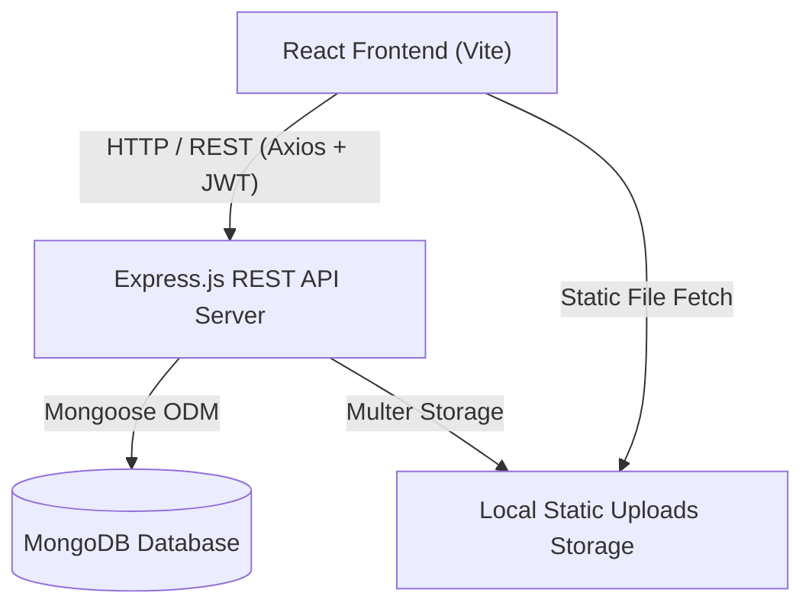

# ChallengeHub

> **Create. Challenge. Complete.**  
> A full-stack web application designed for creating, tracking, and collaborating on personal and group challenges across multiple categories.

---

## Table of Contents

- [Overview](#overview)
- [Key Features](#key-features)
- [Technology Stack](#technology-stack)
- [System Architecture](#system-architecture)
- [Repository Structure](#repository-structure)
- [Prerequisites](#prerequisites)
- [Environment Configuration](#environment-configuration)
- [Installation and Setup](#installation-and-setup)
  - [Backend Setup](#backend-setup)
  - [Frontend Setup](#frontend-setup)
- [Database Configuration](#database-configuration)
- [API Reference](#api-reference)
- [Screenshots](#screenshots)
- [Future Enhancements](#future-enhancements)

---

## Overview

**ChallengeHub** is an all-in-one goal tracking and community challenge platform. Whether you want to establish a fitness habit, complete a 30-day coding bootcamp, read books with peers, or organize competitive skill-development milestones within a private community, ChallengeHub provides structured task tracking, proof verification, real-time notifications, and progress analytics.

---

## Key Features

### 1. Challenge Management & Discovery
- **Multi-Category Challenges:** Categorize challenges by Coding, Fitness, Learning, Reading, Creativity, Photography, Competition, and more.
- **Granular Access Control:**
  - **Public:** Open to any registered user.
  - **Private:** Restricted to explicitly invited participants.
  - **Community:** Exclusive to members of a designated community.
- **Milestones & Tasks:** Break challenges into ordered tasks with specific deadlines and completion criteria.
- **Search & Filtering:** Search challenges by title, description, or category, with filter controls for access type, status, and custom sorting (newest, oldest, start date, title).

### 2. Participation & Proof Verification
- **One-Click Participation:** Join and leave challenges dynamically.
- **Proof Submission:** Submit task proof via text explanations and/or file attachments (JPG, PNG, PDF up to 5 MB).
- **Creator Review Workflow:** Challenge creators review pending submissions, approve or reject them, and provide direct feedback.
- **Automatic Progress Recalculation:** Progress percentages update automatically upon task completion or proof approval, awarding completion badges when all tasks are achieved.

### 3. Communities & Social Collaboration
- **Community Hub:** Create interest groups and invite users to join.
- **Community-Only Challenges:** Host exclusive challenges tied directly to your community group.

### 4. Interactive Dashboard & Analytics
- **User Dashboard:** High-level summary of active challenges, completion rates, and quick shortcuts.
- **Visual Analytics:** Interactive charts powered by Recharts on challenge statistics pages.
- **In-App Notifications:** Real-time bell notifications for new joiners, submission reviews, approvals, rejections, and challenge completions.
- **User Profiles:** Customizable bios, avatars, and searchable member profiles.

---

## Technology Stack

### Frontend
- **Framework:** React 19 (Vite)
- **Routing:** React Router v7
- **HTTP Client:** Axios (with Bearer token interceptors)
- **Data Visualization:** Recharts
- **Icons:** Lucide React
- **Code Quality:** Oxlint

### Backend
- **Runtime:** Node.js (CommonJS)
- **Framework:** Express 5
- **Database:** MongoDB via Mongoose ODM
- **Authentication:** JSON Web Tokens (JWT) & bcrypt password hashing
- **File Uploads:** Multer with secure random filename generation and MIME type validation
- **CORS:** Cross-Origin Resource Sharing with configurable client origin

---

## System Architecture



---

## Repository Structure

```
ChallengeHub/
├── .gitignore                      # Root Git ignore rules
├── README.md                       # Comprehensive project documentation
├── backend/
│   ├── .env.example                # Backend environment template
│   ├── .gitignore                  # Backend Git ignore rules
│   ├── package.json                # Backend dependencies and scripts
│   ├── server.js                   # Express application entrypoint
│   ├── controllers/                # Request handlers and business logic
│   │   ├── authController.js
│   │   ├── challengeController.js
│   │   ├── communityController.js
│   │   ├── notificationController.js
│   │   ├── participationController.js
│   │   ├── submissionController.js
│   │   ├── taskController.js
│   │   └── userController.js
│   ├── middleware/                 # Middleware functions
│   │   ├── authMiddleware.js       # JWT authentication and user extraction
│   │   └── uploadMiddleware.js     # Multer file upload validation & security
│   ├── models/                     # Mongoose schemas and models
│   │   ├── Challenge.js
│   │   ├── Community.js
│   │   ├── Notification.js
│   │   ├── Participation.js
│   │   ├── Submission.js
│   │   ├── Task.js
│   │   └── User.js
│   ├── routes/                     # Express route declarations
│   │   ├── authRoutes.js
│   │   ├── challengeRoutes.js
│   │   ├── communityRoutes.js
│   │   ├── notificationRoutes.js
│   │   ├── submissionRoutes.js
│   │   ├── taskRoutes.js
│   │   └── userRoutes.js
│   ├── services/                   # Modular service utilities
│   │   ├── challengeAccessService.js
│   │   └── notificationService.js
│   └── uploads/                    # Directory for user-submitted proof files
│       └── .gitkeep
└── frontend/
    ├── .env.example                # Frontend environment template
    ├── .gitignore                  # Frontend Git ignore rules
    ├── .oxlintrc.json              # Oxlint linter configuration
    ├── index.html                  # HTML entry point
    ├── package.json                # Frontend dependencies and scripts
    ├── vite.config.js              # Vite configuration
    ├── public/                     # Public assets
    └── src/
        ├── App.css                 # Application styling
        ├── App.jsx                 # Route definitions and layout
        ├── index.css               # Global base styles
        ├── main.jsx                # React root mount
        ├── assets/                 # Static images and icons
        ├── components/             # Reusable UI components
        │   ├── ChallengeCard.jsx
        │   ├── ChallengeForm.jsx
        │   ├── CompletionBadge.jsx
        │   ├── EmptyState.jsx
        │   ├── LoadingSpinner.jsx
        │   ├── NotificationBell.jsx
        │   ├── ProgressBar.jsx
        │   ├── ProtectedRoute.jsx
        │   └── SubmissionStatus.jsx
        ├── context/                # React context providers
        │   ├── AuthContext.jsx
        │   └── NotificationContext.jsx
        ├── pages/                  # Application views
        │   ├── ChallengeDetails.jsx
        │   ├── Challenges.jsx
        │   ├── ChallengeStats.jsx
        │   ├── Communities.jsx
        │   ├── CommunityDetail.jsx
        │   ├── CreateChallenge.jsx
        │   ├── Dashboard.jsx
        │   ├── EditChallenge.jsx
        │   ├── JoinedChallenges.jsx
        │   ├── Login.jsx
        │   ├── MyChallenges.jsx
        │   ├── Notifications.jsx
        │   ├── Profile.jsx
        │   ├── Register.jsx
        │   ├── SubmissionReview.jsx
        │   └── UserProfile.jsx
        └── services/
            └── api.js              # Axios instance and request interceptors
```

---

## Prerequisites

Before running the application, make sure you have installed:
- **Node.js** (v18.0.0 or higher recommended, tested on Node.js v20+)
- **npm** (v9.0.0 or higher)
- **MongoDB** (v6.0 or higher running locally or a MongoDB Atlas URI)

---

## Environment Configuration

### Backend (`backend/.env`)

Create a `.env` file in the `backend/` directory by copying `backend/.env.example`:

```bash
cd backend
cp .env.example .env
```

Populate the following variables:

| Variable | Description | Default / Example |
| :--- | :--- | :--- |
| `PORT` | Port for the Express backend server | `5000` |
| `CLIENT_URL` | Frontend origin allowed by CORS | `http://localhost:5173` |
| `MONGODB_URI` | MongoDB connection string | `mongodb://localhost:27017/challengehub` |
| `JWT_SECRET` | Secret key used to sign JWT tokens | `<strong-random-secret-key>` |
| `JWT_EXPIRES_IN` | Token validity duration | `7d` |

### Frontend (`frontend/.env`)

Create a `.env` file in the `frontend/` directory if you need to point to a non-default API endpoint:

```bash
cd frontend
cp .env.example .env
```

| Variable | Description | Default |
| :--- | :--- | :--- |
| `VITE_API_URL` | Base API endpoint for the Express backend | `http://localhost:5000/api` |

---

## Installation and Setup

### 1. Clone the Repository

```bash
git clone <repository-url>
cd ChallengeHub
```

### 2. Backend Setup

```bash
cd backend

# Install dependencies
npm install

# Start the server (production mode)
npm start

# Or start in watch mode for development
npm run dev
```

The backend server will run on `http://localhost:5000`.

### 3. Frontend Setup

In a new terminal window:

```bash
cd frontend

# Install dependencies
npm install

# Start the Vite development server
npm run dev
```

The frontend application will be accessible at `http://localhost:5173`.

---

## Database Configuration

ChallengeHub uses MongoDB as its primary datastore.

1. **Local MongoDB:**  
   Ensure your local MongoDB daemon is running:
   ```bash
   # Linux / macOS
   mongod --dbpath /data/db

   # Windows
   net start MongoDB
   ```
2. **MongoDB Atlas (Cloud):**  
   Replace `MONGODB_URI` in `backend/.env` with your connection string:
   ```env
   MONGODB_URI=mongodb+srv://<username>:<password>@cluster0.mongodb.net/challengehub?retryWrites=true&w=majority
   ```

---

## API Reference

### Authentication (`/api/auth`)
| Method | Endpoint | Description | Auth Required |
| :--- | :--- | :--- | :--- |
| `POST` | `/api/auth/register` | Register a new user | No |
| `POST` | `/api/auth/login` | Login with email/username and password | No |
| `GET` | `/api/auth/me` | Fetch authenticated user details | Yes |

### Users (`/api/users`)
| Method | Endpoint | Description | Auth Required |
| :--- | :--- | :--- | :--- |
| `GET` | `/api/users/search?q=` | Search users by name, username, or email | Yes |
| `GET` | `/api/users/me/challenges` | Get challenges joined by the current user | Yes |
| `GET` | `/api/users/:id` | Get public profile by user ID | Yes |
| `PUT` | `/api/users/:id` | Update profile (name, bio, username, avatar) | Yes (Owner) |

### Challenges (`/api/challenges`)
| Method | Endpoint | Description | Auth Required |
| :--- | :--- | :--- | :--- |
| `GET` | `/api/challenges` | List challenges (pagination, filtering, search) | Optional |
| `GET` | `/api/challenges/mine` | List challenges created by authenticated user | Yes |
| `GET` | `/api/challenges/:id` | Get challenge details by ID | Optional (Access verified) |
| `POST` | `/api/challenges` | Create a new challenge | Yes |
| `PUT` | `/api/challenges/:id` | Update challenge details | Yes (Creator) |
| `DELETE` | `/api/challenges/:id` | Delete challenge | Yes (Creator) |
| `POST` | `/api/challenges/:id/join` | Join a challenge | Yes |
| `DELETE` | `/api/challenges/:id/leave`| Leave an active challenge | Yes |
| `GET` | `/api/challenges/:id/participation` | Get current user's participation status | Yes |
| `GET` | `/api/challenges/:id/participants` | List participants of a challenge | Optional |
| `GET` | `/api/challenges/:id/tasks` | Get all tasks for a challenge | Optional |
| `POST` | `/api/challenges/:id/tasks` | Create a new task in a challenge | Yes (Creator) |
| `POST` | `/api/challenges/:id/submissions` | Submit proof for a task (text / multipart file) | Yes (Participant) |
| `GET` | `/api/challenges/:id/submissions` | List submissions for a challenge | Yes (Creator/Participant) |
| `GET` | `/api/challenges/:id/submissions/my` | List current user's submissions | Yes |

### Tasks (`/api/tasks`)
| Method | Endpoint | Description | Auth Required |
| :--- | :--- | :--- | :--- |
| `PUT` | `/api/tasks/:id` | Edit task details | Yes (Creator) |
| `DELETE` | `/api/tasks/:id` | Delete task | Yes (Creator) |
| `PATCH` | `/api/tasks/:id/complete` | Mark task completed (self-completion) | Yes (Participant) |

### Submissions (`/api/submissions`)
| Method | Endpoint | Description | Auth Required |
| :--- | :--- | :--- | :--- |
| `PUT` | `/api/submissions/:id/review` | Approve or reject a proof submission | Yes (Creator) |

### Communities (`/api/communities`)
| Method | Endpoint | Description | Auth Required |
| :--- | :--- | :--- | :--- |
| `GET` | `/api/communities` | List all communities | Yes |
| `GET` | `/api/communities/:id` | Get community details and members | Yes |
| `POST` | `/api/communities` | Create a new community | Yes |
| `POST` | `/api/communities/:id/members` | Add member to community | Yes (Creator) |

### Notifications (`/api/notifications`)
| Method | Endpoint | Description | Auth Required |
| :--- | :--- | :--- | :--- |
| `GET` | `/api/notifications` | Get user notifications | Yes |
| `PATCH` | `/api/notifications/:id/read` | Mark a notification as read | Yes |
| `PATCH` | `/api/notifications/read-all` | Mark all notifications as read | Yes |
| `DELETE` | `/api/notifications/:id` | Delete a notification | Yes |

---

## Screenshots

> *Screenshots of ChallengeHub user interface:*

| Dashboard | Explore Challenges |
| :---: | :---: |
| *(Screenshot Placeholder: User Dashboard)* | *(Screenshot Placeholder: Challenges Listing)* |

| Challenge Details & Tasks | Submission Review |
| :---: | :---: |
| *(Screenshot Placeholder: Challenge Details & Progress)* | *(Screenshot Placeholder: Creator Review Panel)* |

---

## Future Enhancements

- [ ] WebSockets / Server-Sent Events (SSE) for instant real-time notification push.
- [ ] Cloud object storage support (AWS S3 / Google Cloud Storage / Cloudinary) for proof uploads.
- [ ] Streak tracking and daily check-in reminders.
- [ ] Leaderboard system with gamified points and badges.
- [ ] Social comments and community discussion threads per challenge.

